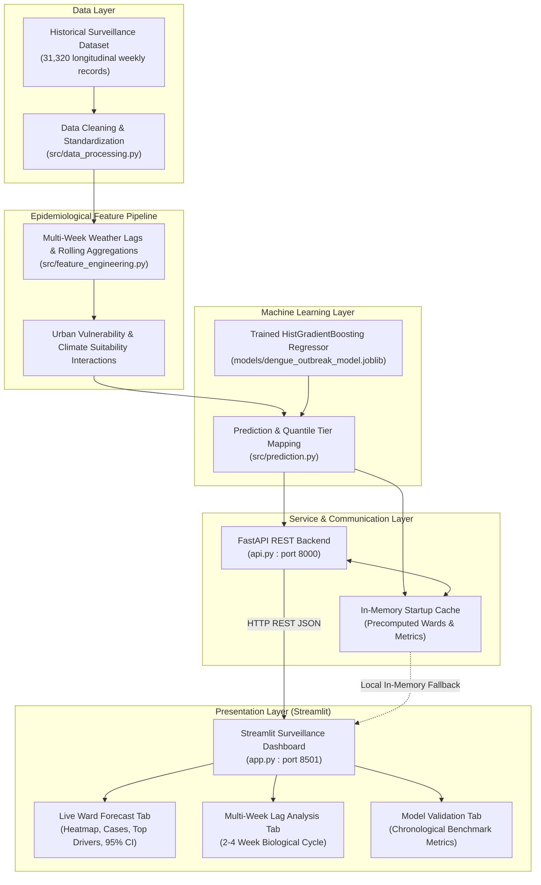
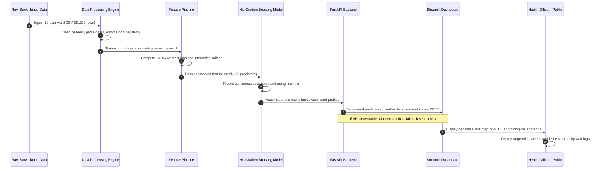

# ADES BIDAI: System Architecture and Technical Design

## 1. Introduction and Project Overview

Dengue fever has emerged as one of the most critical urban public health crises across Bangladesh. Major metropolitan areas, particularly Dhaka, Chattogram, Gazipur, and Narayanganj, experience recurrent seasonal surges that strain clinical infrastructure, overwhelm emergency wards, and result in preventable mortality. Traditional municipal responses in Bangladesh are predominantly reactive. Vector control measures, such as chemical fogging and larvicide application, are typically dispatched only after hospital admissions have already escalated, by which point localized viral transmission is widely established.

ADES BIDAI (Bengali: "এডিস বিদায়", meaning "Farewell to Aedes") was developed to transform this reactive paradigm into proactive, data-driven prevention. The platform is an artificial intelligence-based urban dengue outbreak prediction and early-warning surveillance system designed specifically for administrative wards in Bangladesh. 

Rather than treating dengue as a random public health event, ADES BIDAI models the deterministic biophysical relationship between climate dynamics, urban vulnerabilities, and the biological life cycle of the *Aedes aegypti* mosquito. By analyzing multi-week historical weather patterns alongside ward-level drainage bottlenecks, population density, and sanitation conditions, the system predicts outbreak severity two to four weeks before clinical surges occur. This operational window provides municipal authorities, health workers, and city corporations with actionable intelligence to eliminate breeding sites, mobilize medical supplies, and alert communities well in advance of hospital strain.

---

## 2. System Architecture Overview

ADES BIDAI is architected around a decoupled, modular design that separates raw data processing, epidemiological feature engineering, machine learning inference, backend API services, and user-facing presentation. The system is designed to run completely offline on standard workstation hardware without requiring cloud dependencies, third-party proprietary APIs, or ongoing subscription costs.



The system comprises five core architectural layers:

1. **Data Layer**: Ingests multi-year longitudinal ward observations. It handles schema standardization, temporal sorting, missing value remediation, and physical sanity clipping.
2. **Epidemiological Feature Pipeline**: Transforms raw weather and demographic observations into biologically meaningful predictors, including multi-week delayed rainfall lags and urban vulnerability interaction terms.
3. **Machine Learning Layer**: Houses the trained regression model and quantile mapping logic. It loads serialized artifacts and executes inference in under 15 milliseconds per scenario.
4. **Service Layer (FastAPI)**: Serves prediction results, ward profiles, and historical time series over standardized REST endpoints. The service utilizes in-memory preloading during application startup to guarantee zero runtime disk I/O bottlenecks.
5. **Presentation Layer (Streamlit)**: Delivers an interactive, dark-themed command center tailored for public health epidemiologists, municipal ward commissioners, and citizens. In the event that the standalone FastAPI server is offline, the presentation layer activates a transparent local fallback mode, executing inference directly in memory.

---

## 3. Complete System Workflow

The end-to-end lifecycle of information across ADES BIDAI follows a disciplined pipeline from historical records to field-level public health alerts:



1. **Ingestion and Normalization**: The data processing module ingests the raw longitudinal dataset, standardizes variable naming, validates calendar timestamps, and sorts records strictly by ward identifier and date.
2. **Feature Computation**: The feature pipeline processes records on a per-ward basis. By shifting time series backwards, it computes multi-week lag windows for precipitation, temperature, and humidity without creating future lookahead bias.
3. **Offline Training and Evaluation**: During development, models are trained on historical data up through 2023 and rigorously validated against 2024–2025 holdout observations using a strict chronological split.
4. **Model Serialization and In-Memory Initialization**: The winning model artifact is saved to disk via `joblib`. When the system starts, FastAPI and Streamlit load this artifact into memory once, ensuring instantaneous operational availability.
5. **Inference and Public Health Classification**: When a query for a ward is initiated, the system extracts the corresponding feature vector, generates a continuous expected case count, calculates uncertainty bounds, and maps the output into a categorical risk tier.
6. **Visualization and Operational Action**: Health officers review live risk maps, inspect the specific environmental drivers contributing to elevated scores, and direct municipal field teams to specific hotspots before hospital surges materialize.

---

## 4. Dataset and Data Processing

### Dataset Scope and Spatial Granularity

The surveillance system is powered by a high-resolution longitudinal dataset covering 10 full calendar years, from January 4, 2016, through December 29, 2025. The data is organized into weekly observation intervals across 60 administrative urban wards located in 5 key Bangladesh City Corporations:

- **Dhaka North City Corporation (DNCC)**: 20 wards
- **Dhaka South City Corporation (DSCC)**: 15 wards
- **Chattogram City Corporation (CCC)**: 15 wards
- **Gazipur City Corporation (GCC)**: 5 wards
- **Narayanganj City Corporation (NCC)**: 5 wards

With 522 weeks observed across 60 wards, the dataset comprises exactly 31,320 longitudinal weekly records.

### Data Ingestion and Cleansing Pipeline

Raw municipal and meteorological data frequently suffer from inconsistent column headers, missing entries, duplicate logging, and formatting discrepancies. The module `src/data_processing.py` executes a rigorous data preparation pipeline:

- **Header Standardization**: Strips leading and trailing whitespace and converts all variable names to lowercase snake_case.
- **Timestamp Standardization**: Parses the `date` column into standard pandas `Timestamp` objects.
- **Chronological Sorting**: Enforces strict sorting using the composite key `['ward_id', 'date']`. This step is essential because all subsequent lag calculations rely on sequential ordering within individual wards.
- **Deduplication**: Identifies and eliminates redundant rows matching identical `ward_id` and `date` combinations.
- **Type Coercion and Range Validation**: Enforces numeric casting on physical measurements and clips negative values. Dengue cases are clamped to non-negative integers ($\ge 0$), rainfall is constrained to non-negative values ($\ge 0.0\text{ mm}$), and relative humidity is bounded within physical limits ($[0.0\%, 100.0\%]$).
- **Memory Footprint Optimization**: Columns are downcast to appropriate float32 and int32 types where possible, keeping the active dataframe footprint under 2 MB, which enables microsecond-level filtering during real-time user sessions.

---

## 5. Feature Engineering and Its Epidemiological Importance

### The Biological Vector Life Cycle and Meteorological Lags

A primary limitation of naive dengue prediction models is attempting to correlate current-week rainfall directly with current-week clinical cases. From an entomological perspective, rainfall does not produce dengue patients immediately. Precipitation initiates an ecological chain reaction governed by the life cycle of the *Aedes aegypti* mosquito and the viral replication dynamics inside the vector.

```
Rainfall Event (Week 0)
    │
    ▼ [7 to 10 Days]
Eggs hatch in standing water; larvae develop into pupae and emerge as adult mosquitoes
    │
    ▼ [2 to 3 Days]
Adult female takes blood meal from an infected human host
    │
    ▼ [8 to 12 Days: Extrinsic Incubation Period]
Dengue virus replicates inside the vector and migrates to salivary glands
    │
    ▼ [4 to 7 Days: Intrinsic Incubation Period]
Infective mosquito bites susceptible human; viral incubation precedes symptom onset
    │
    ▼
Clinical Outbreak / Hospital Admission Surge (Weeks 3 to 4)
```

Because of this 3-to-4-week biological delay, `src/feature_engineering.py` constructs multi-week delayed features:

- `rainfall_lag_1w`, `rainfall_lag_2w`, `rainfall_lag_3w`, `rainfall_lag_4w`: Captured strictly per ward using `.groupby('ward_id')['rainfall_mm'].shift(n)`. This isolates the exact historical precipitation window responsible for current adult mosquito abundance.
- `rainfall_roll_sum_4w` and `rainfall_roll_mean_4w`: Quantifies sustained environmental water saturation over the preceding month. Prolonged accumulation indicates widespread, persistent breeding grounds in discarded containers, construction trenches, and stagnant drains.
- `avg_temp_lag_1w`, `avg_temp_lag_2w`, `avg_temp_lag_3w`: Ambient temperature governs the speed of larval development and modulates the extrinsic incubation period. Warmer temperatures (optimal around 28°C–30°C) shorten viral replication time inside the mosquito, accelerating transmission risk.
- `humidity_lag_1w`, `humidity_lag_2w`, `humidity_lag_3w`: High relative humidity (above 65%–70%) enhances adult mosquito longevity, allowing female vectors to survive long enough to complete the extrinsic incubation period and transmit the virus across multiple blood meals.

### Preventing Temporal Data Leakage

To preserve strict real-world validity, all rolling window calculations apply a `.shift(1)` guard prior to aggregation:

```python
df["rainfall_roll_mean_4w"] = grouped["rainfall_mm"].transform(
    lambda s: s.shift(1).rolling(window=4, min_periods=1).mean()
)
```

This prevents future lookahead bias by ensuring that predictions for any given week rely exclusively on completed meteorological measurements from prior weeks. The initial 4 burn-in weeks per ward are cleanly pruned from training to eliminate uninitialized lag artifacts.

### Urban Vulnerability Interactions and Environmental Indices

Physical infrastructure determines whether rainfall transforms into an outbreak. Equal rainfall yields vastly different transmission rates in a modern, well-drained neighborhood compared to a densely crowded ward with open drainage bottlenecks. The feature pipeline models these relationships directly:

- `rain_lag2_x_waterlog`: Interacts the 2-week rainfall lag with the ward's water-logging risk index. High values indicate standing water trapped in poorly drained terrain precisely when larvae are maturing.
- `rain_lag2_x_unsanitary`: Interacts rainfall lags with an unsanitary conditions score (`1.0 - sanitation_score`). High scores reflect heavy precipitation falling on uncollected solid waste and discarded plastic receptacles, which serve as ideal artificial breeding containers.
- `composite_vulnerability_index`: An equal-weighted composite combining drainage vulnerability and solid waste deficiency into an overarching structural risk score.
- `density_exposure_factor`: Scales ward population density against structural vulnerability, modeling the increased human-to-vector contact rate in crowded urban settlements.
- `vector_climate_suitability`: A non-linear biological suitability index combining a Gaussian temperature curve centered at 28.5°C with a logistic humidity response function, quantifying overall environmental favorability for vector reproduction.
- `Calendar Seasonality Features`: Encodes month, ISO week number, monsoon window flags, and cyclical trigonometric features (`sin_week`, `cos_week`, `sin_month`, `cos_month`) to capture annual monsoon cycles smoothly across year-end boundaries.

---

## 6. Machine Learning Model Development

### Problem Formulation

ADES BIDAI frames dengue early warning as a continuous regression task coupled with downstream categorical risk tier classification. The primary target variable is the total weekly count of reported dengue cases in an administrative ward (`dengue_cases`).

Predicting continuous case counts rather than directly training a multi-class classifier preserves the quantitative magnitude of outbreaks, maintains ordinal integrity between mild increases and severe epidemics, and allows public health planners to forecast exact hospital bed demand.

### Strict Chronological Train-Validation-Test Split

A frequent mistake in spatial-temporal public health modeling is the use of standard random k-fold cross-validation. Randomly shuffling rows across time causes severe **data leakage**: future observations contaminate the training fold, allowing the algorithm to memorize future outbreak trajectories and yielding artificially inflated validation scores that collapse during real-world deployment.

To guarantee honest out-of-sample evaluation, ADES BIDAI enforces a strict chronological split:

- **Training Period**: January 4, 2016 through December 31, 2023 (416 weeks, 24,960 total ward observations across all 60 wards).
- **Holdout Test Period**: January 1, 2024 through December 29, 2025 (104 weeks, 6,240 total ward observations across all 60 wards).

The model is trained solely on data up to the end of 2023 and evaluated on the subsequent two years of unseen future data, precisely replicating how the platform performs when deployed in an active municipal setting.

---

## 7. Model Comparison and Selection

### Benchmark Methodology

Three diverse machine learning architectures were trained on identical feature sets and evaluated against the 6,240 out-of-sample holdout observations:

1. **Ridge Regression Baseline**: An L2-regularized linear baseline to establish the linear predictability limit of the feature set.
2. **Random Forest Regressor**: An ensemble of 60 decision trees (`max_depth=10`, `min_samples_split=4`) capturing non-linear feature interactions and high-order combinations.
3. **HistGradientBoosting Regressor**: A histogram-based gradient boosting decision tree ensemble (`max_iter=180`, `learning_rate=0.08`, `max_depth=6`, `random_state=42`) using native integer binning.

### Out-of-Sample Performance Comparison

The models were evaluated across Mean Absolute Error (MAE), Root Mean Squared Error (RMSE), Coefficient of Determination ($R^2$), and Risk Tier Classification Accuracy:

| Model Architecture | Mean Absolute Error (MAE) | Root Mean Squared Error (RMSE) | Coefficient of Determination ($R^2$) | Risk Tier Accuracy (%) | Selection Status |
| :--- | :---: | :---: | :---: | :---: | :---: |
| **Ridge Regression Baseline** | 1.057 | 1.858 | 0.768 | 79.81% | Baseline Rejected |
| **Random Forest Regressor** | 0.868 | 1.631 | 0.822 | 84.92% | Candidate Rejected |
| **HistGradientBoosting Regressor** | **0.827** | **1.554** | **0.838** | **85.59%** | **Winning Production Model** |

### Why HistGradientBoosting Was Selected

HistGradientBoosting outperformed both competing architectures across all evaluation criteria:

- **Superior Predictive Accuracy**: Achieved the lowest MAE (0.827 cases per week) and lowest RMSE (1.554), demonstrating balanced performance across both sporadic baseline weeks and sharp epidemic surges.
- **Effective Modeling of Non-Linear Thresholds**: Vector population dynamics exhibit sharp threshold behaviors. Mosquito survival drops rapidly when temperatures exceed 35°C or humidity falls below 60%. Histogram-binned gradient boosted trees capture these non-linear step changes significantly better than linear baselines.
- **Handling of Zero-Inflated Distributions**: In non-monsoon months, many urban wards report zero cases. Gradient boosted loss minimization adapts effectively to zero-inflated distributions without predicting extreme negative values.
- **Native Missing Value Routing**: The algorithm bins continuous variables into discrete integer buckets (typically 256 bins) and natively handles missing values during split finding, eliminating the need for synthetic data imputation.
- **Computational and Memory Efficiency**: The trained model serializes to a lightweight binary file under 500 KB and executes inference across an entire city ward roster in under 15 milliseconds, ensuring smooth, lag-free user interaction.

---

## 8. Dengue Risk Classification

### Quantile-Derived Risk Tiers

Continuous numerical predictions are translated into categorical risk tiers to provide direct operational guidance to municipal officers who may not have statistical training. 

Fixed, arbitrary thresholds fail in epidemiology because disease distributions are heavily skewed. ADES BIDAI establishes dynamic thresholds derived from the empirical percentiles of the historical training distribution:

- **Low Risk (< 1.5 predicted cases/week)**: Represents the 0 to 50th percentile. Baseline sporadic activity where transmission is minimal and isolated.
- **Medium Risk (1.5 to 4.0 predicted cases/week)**: Represents the 50th to 75th percentile. Emerging localized vector breeding; conditions favor accelerated viral replication.
- **High Risk (4.0 to 10.0 predicted cases/week)**: Represents the 75th to 90th percentile. Active cluster transmission with expanding case counts; containment is urgently required.
- **Critical Risk ($\ge$ 10.0 predicted cases/week)**: Represents the top 10th percentile (> 90th percentile). Severe epidemic surge indicating widespread community transmission and imminent hospital emergency ward saturation.

### Operational Intervention Playbook

Each risk tier triggers specific, prioritized actions across administrative and municipal levels:

| Risk Tier | Case Threshold | Epidemiological Status | Recommended Public Health Action |
| :--- | :--- | :--- | :--- |
| **Low** | < 1.5 cases/week | Sporadic baseline | Routine surveillance; standard drain clearing; continuous public awareness messaging. |
| **Medium** | 1.5 – 4.0 cases/week | Vector breeding emergence | Targeted biological larvicide application; inspection of construction sites; cleaning clogged surface drains. |
| **High** | 4.0 – 10.0 cases/week | Active localized outbreak | Intensive thermal fogging in 500-meter cluster radius; door-to-door community inspection; clinic fever corner activation. |
| **Critical** | $\ge$ 10.0 cases/week | Epidemic surge | Emergency municipal vector containment; hospital bed reservation protocols; ward-level emergency coordination meetings. |

---

## 9. Prediction Confidence and Limitations

### Estimation of Uncertainty Intervals

Point forecasts can convey a false sense of certainty in disease surveillance. To provide decision-makers with a clear range of potential outcomes, ADES BIDAI provides an uncertainty bound around every prediction:

$$\text{Lower Bound} = \max(0, \hat{y} - 1.5 \times \text{MAE})$$

$$\text{Upper Bound} = \hat{y} + 1.5 \times \text{MAE}$$

Where $\hat{y}$ is the model's point prediction and $\text{MAE} = 0.827$. Under approximately normal error residuals, a $1.5 \times \text{MAE}$ multiplier spans approximately 85% to 90% of expected variation. Negative lower bounds are clipped to zero, as negative dengue cases are physically impossible.

### Technical and Epidemiological Limitations

Responsible operational deployment requires transparent disclosure of the system's inherent constraints:

- **Engineering Approximation of Confidence Intervals**: The $\pm 1.5 \times \text{MAE}$ interval is a practical heuristic designed for responsive web delivery. It does not replace formal conformal inference or computationally intensive bootstrap prediction intervals.
- **Absence of Real-Time Viral Serotype Data**: Dengue transmission severity is strongly influenced by circulating viral serotypes (DENV-1 through DENV-4). Secondary infection with a heterologous serotype can lead to antibody-dependent enhancement and severe clinical complications. Because national surveillance data in Bangladesh does not consistently report ward-level serotyping, the model currently relies on environmental and historical transmission proxies.
- **Hospital Underreporting and Reporting Lags**: The ground-truth dataset reflects patients who sought care and received clinical or serological confirmation (NS1 or IgM/IgG). Mild or asymptomatic infections that do not result in formal hospital admissions are uncaptured, meaning actual community infection rates are higher than official counts.
- **Macro vs. Micro-Climate Discrepancies**: Meteorological features are recorded from municipal weather stations. Local microclimates—such as shaded alleys, indoor water storage tanks, and individual rooftop gardens—can sustain mosquito colonies even when regional weather parameters appear suboptimal.

---

## 10. Backend Architecture and API Communication

The backend is built using FastAPI (`api.py`), providing an asynchronous, OpenAPI-compliant REST interface. It is architected for maximum responsiveness through in-memory caching and clean separation of concerns.

### Application Startup and In-Memory Initialization

To eliminate redundant disk reads and runtime model initialization delays, `api.py` leverages FastAPI startup lifecycle events:

1. **Data Ingestion**: Loads the cleaned dataset and runs the complete feature engineering pipeline once, storing the resulting matrices in global memory.
2. **Artifact Deserialization**: Loads `models/dengue_outbreak_model.joblib` and caches the estimator, feature column list, and quantile thresholds.
3. **Precomputing Surveillance State**: Generates and caches predictions for the most recent observation week across all 60 wards, enabling instantaneous serving upon startup.

### Primary API Endpoints

| Method | Endpoint Route | Description and Responsibilities |
| :--- | :--- | :--- |
| `GET` | `/api/health` | Verifies service health, active model name, and system uptime. |
| `GET` | `/api/summary` | Delivers aggregate citywide metrics, including total predicted cases and ward risk distribution. |
| `GET` | `/api/wards` | Returns the latest risk status, coordinates, predicted cases, and top drivers for all 60 wards. |
| `GET` | `/api/ward/{ward_id}` | Provides granular longitudinal time-series data and static features for a specific ward. |
| `GET` | `/api/predict` | Executes dynamic, scenario-based inference on arbitrary user-provided feature inputs. |
| `GET` | `/api/weather/{ward_id}` | Returns multi-week weather lag observations (rainfall, temperature, humidity) for a ward. |
| `GET` | `/api/metrics` | Serves out-of-sample benchmark validation metrics (MAE, RMSE, $R^2$, Tier Accuracy). |
| `GET` | `/api/comparison` | Provides side-by-side metric comparisons between two selected wards. |
| `GET` | `/api/environmental` | Computes correlation matrices between environmental drivers and dengue case counts. |

---

## 11. Frontend Architecture and User Interaction

The user-facing dashboard is implemented in Streamlit (`app.py`), featuring a cohesive dark-themed user interface (`#0B1120` canvas, `#111827` surface cards, and `#06B6D4` cyan accents) designed for clarity under high-pressure public health workflows.

### Seamless Backend Communication and Local Fallback

The frontend communicates with the FastAPI service over standard HTTP REST calls (`http://localhost:8000`). To guarantee uninterrupted operation even if the standalone API process terminates or the network is disrupted, the dashboard incorporates an automatic in-memory fallback:

```python
try:
    resp = requests.get(f"{API_BASE_URL}/api/wards", timeout=2.0)
    data = resp.json()
except Exception:
    # Transparent Local Fallback Mode
    data = load_local_predictions_in_memory()
```

This dual-mode architecture guarantees that field workers in low-connectivity environments retain complete access to model forecasts and interactive tools without experiencing application crashes.

### Surveillance Modules

The interface is structured into three primary surveillance views:

1. **Live Ward Forecast**: Presents an interactive geospatial ward map color-coded by risk tier alongside an epidemiological summary banner. Selecting any ward reveals a forecast card displaying expected cases, 95% uncertainty bounds, primary environmental drivers, and a dual-axis trend chart overlaying historical cases against rainfall.
2. **Multi-Week Lag Analysis**: Educates decision-makers on the biological transmission cycle. Users can visualize 1-week through 4-week rainfall lag distributions, examine temperature and humidity suitability curves, and track 52-week longitudinal vectors across any selected municipality.
3. **Model Validation**: Provides complete transparency into model accuracy. Displays out-of-sample holdout metrics comparing HistGradientBoosting against Random Forest and Ridge Regression, visually demonstrates the strict chronological split, and reviews the dynamic quantile threshold methodology.

---

## 12. Project Folder and File Structure

The repository is organized cleanly by functional responsibility:

```
ADES-BIDAI/
├── .streamlit/
│   └── config.toml                  # Streamlit dark theme configuration and server parameters
├── assets/
│   ├── reference_dashboard.jpg      # Visual design reference and layout benchmarks
│   └── media_*.jpg                  # UI assets and documentation media
├── data/
│   ├── google_sheet_dengue_dataset.csv  # Primary 10-year longitudinal surveillance dataset
│   └── dashboard_precomputed.json   # Precomputed ward aggregates for rapid offline startup
├── models/
│   ├── dengue_outbreak_model.joblib # Serialized production HistGradientBoosting model artifact
│   └── metrics_summary.json         # Out-of-sample validation benchmark metrics
├── src/
│   ├── __init__.py                  # Package initialization
│   ├── data_processing.py           # Ingestion, cleaning, sorting, and type validation
│   ├── feature_engineering.py       # Multi-week lag calculations, rolling statistics, and indices
│   ├── prediction.py                # Local inference engine, quantile mapping, and driver analysis
│   └── train_model.py               # Chronological model training, evaluation, and serialization
├── utils/
│   ├── __init__.py                  # Utility package initialization
│   └── ward_coordinates.py          # Geospatial centroids and boundaries for all 60 wards
├── api.py                           # Standalone FastAPI REST backend server
├── app.py                           # Primary Streamlit surveillance dashboard application
├── ARCHITECTURE.md                  # Comprehensive system architecture documentation (this document)
├── README.md                        # Project landing page and high-level setup guide
├── requirements.txt                 # Pinned Python package dependencies
└── run.bat                          # Single-command Windows startup script with thread safety
```

---

## 13. Performance, Caching, and Cost Efficiency

### Zero Cloud and API Costs

A core design objective of ADES BIDAI is operational sustainability. Many contemporary AI applications rely on closed-source, cloud-hosted large language models that incur ongoing API token fees, network latency, and data privacy concerns. 

ADES BIDAI operates with **zero ongoing cloud costs**:
- **Offline Inference**: Inference is powered by an optimized, locally serialized Scikit-learn model requiring no external network calls.
- **Zero Token Fees**: No recurring per-query charges or third-party cloud subscriptions are incurred.
- **Edge Deployability**: The entire platform runs efficiently on standard laptop or desktop hardware within municipal health offices.

### Memory Optimization and OpenBLAS Thread Safety

On Windows environments running scientific Python libraries, concurrent multi-threaded linear algebra backends (OpenBLAS and MKL) can occasionally trigger memory access conflicts under high-concurrency Streamlit re-renders. ADES BIDAI enforces single-threaded backend execution via environment variables configured in `run.bat` and application entrypoints:

```bat
set OPENBLAS_NUM_THREADS=1
set MKL_NUM_THREADS=1
set OMP_NUM_THREADS=1
set NUMEXPR_NUM_THREADS=1
```

This configuration stabilizes thread allocation, eliminates segmentation risks, and reduces total application memory usage to under 250 MB. In addition, Streamlit caching primitives (`@st.cache_data` and `@st.cache_resource`) ensure that datasets and model artifacts are loaded into memory once and reused across all active browser sessions.

---

## 14. Installation and Execution Guide

### Prerequisites

- Operating System: Windows 10/11, Ubuntu 20.04+, or macOS
- Python Runtime: Python 3.10 through 3.12 (Python 3.14+ is not recommended due to pre-compiled binary compatibility requirements)
- Package Manager: `pip`

### Step-by-Step Installation

1. **Clone the Repository**:
   ```bash
   git clone https://github.com/AfrinSultanaTazkia/ADES-BIDAI.git
   cd ADES-BIDAI
   ```

2. **Create and Activate a Virtual Environment**:
   ```bash
   # Windows
   python -m venv venv
   .\venv\Scripts\activate

   # Linux / macOS
   python3 -m venv venv
   source venv/bin/activate
   ```

3. **Install Dependencies**:
   ```bash
   pip install --upgrade pip
   pip install -r requirements.txt
   ```

4. **Retrain or Verify Model Artifacts (Optional)**:
   The pre-trained model artifact is included in `models/dengue_outbreak_model.joblib`. To retrain the model and regenerate benchmark metrics:
   ```bash
   python src/train_model.py
   ```

### Running the System

You can run the system using the provided single-command launcher or by starting services independently:

- **Single-Command Launch (Windows)**:
  Double-click `run.bat` or run:
  ```cmd
  run.bat
  ```

- **Independent Service Launch**:
  Terminal 1 (FastAPI Backend):
  ```bash
  python api.py
  # API live at: http://localhost:8000
  # Interactive Docs: http://localhost:8000/docs
  ```

  Terminal 2 (Streamlit Dashboard):
  ```bash
  streamlit run app.py --server.port 8501
  # Dashboard live at: http://localhost:8501
  ```

---

## 15. Reproducibility and Future Improvements

### Reproducibility Framework

To ensure that reported results are fully reproducible across different environments, ADES BIDAI adheres to strict deterministic guidelines:
- **Fixed Random Seeds**: All stochastic processes in model training (`HistGradientBoostingRegressor` and `RandomForestRegressor`) use `random_state=42`.
- **Deterministic Pipeline Execution**: Feature transformations follow explicit mathematical equations without non-deterministic sampling.
- **Tracked Model Artifacts**: Model parameters, feature column orderings, and dynamic quantile boundaries are versioned in `models/dengue_outbreak_model.joblib` and audited against `models/metrics_summary.json`.

### Future Engineering Roadmap

The system is designed to accommodate planned future enhancements:

1. **Satellite Remote Sensing Integration**: Incorporate real-time European Space Agency (Sentinel-2) multi-spectral imagery to compute Normalized Difference Water Index (NDWI) and Normalized Difference Vegetation Index (NDVI) at 10-meter spatial resolution, dynamically capturing localized rainwater pooling.
2. **Syndromic Clinical Surveillance Ingestion**: Establish direct, anonymized data pipelines with DGHS (Directorate General of Health Services) and municipal hospitals to ingest daily outpatient fever visits, further narrowing the gap between vector emergence and formal clinical registration.
3. **Automated Vector Fogging Telemetry**: Integrate GPS-tracked municipal insecticide spray trucks into the ward dashboard to evaluate the real-world reduction in dengue cases following localized containment interventions.
