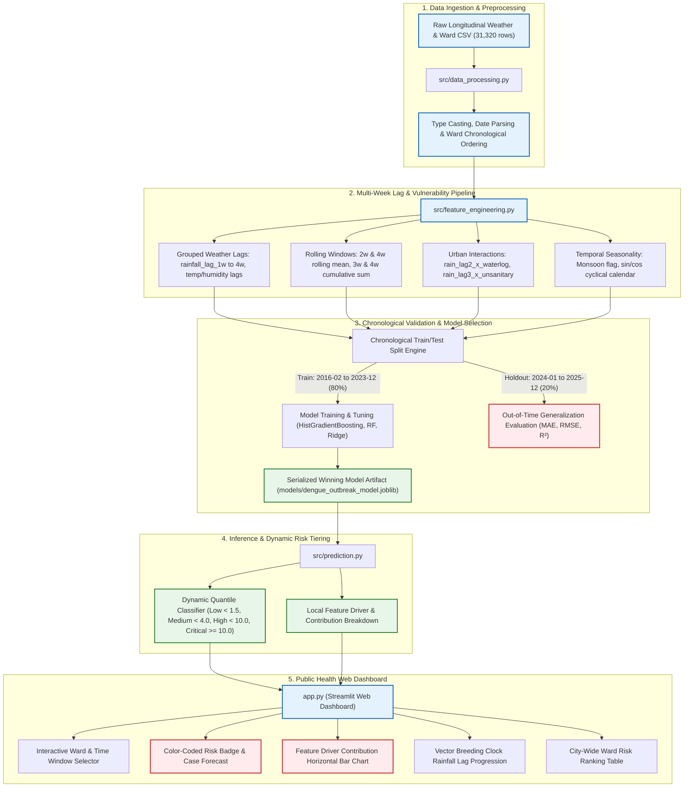

# ADES BIDAI: System Architecture & Design Document

**System Name**: ADES BIDAI (AI-Powered Urban Dengue Outbreak Early-Warning System)  
**Version**: 1.0 (Preliminary Hackathon Qualifier Release)  
**Target Domain**: Public Health Dengue Outbreak Surveillance & Municipal Vector Control  

---

## 1. System Overview

ADES BIDAI is a machine learning early-warning surveillance engine designed to predict hyper-local dengue outbreak surges across Bangladeshi urban centers (Dhaka North, Dhaka South, Chattogram, Gazipur, and Narayanganj). 

Unlike traditional reactive spraying operations that respond *after* emergency wards reach maximum capacity, ADES BIDAI bridges the critical **2-to-4-week biological vector breeding clock**—the delay between heavy precipitation, stagnant water accumulation in urban drainage bottlenecks, mosquito larval emergence, viral incubation, and human hospital admissions.

---

## 2. End-to-End System Data Flow Diagram

---

## 3. The Multi-Week Weather Lag & Vector Breeding Pipeline

### Biological Foundation
Aedes aegypti breeding and dengue virus transmission follow a strict non-linear biological progression:
1. **Weeks 4 to 3 (Egg to Pupa)**: Rain falls into artificial containers and clogged drains; eggs hatch into larvae (7–10 days).
2. **Week 2 (Adult Emergence)**: Pupae mature into adult mosquitoes; warm temperatures (\(25^\circ\text{C} - 32^\circ\text{C}\)) accelerate metabolic activity.
3. **Week 1 (Dispersion & Biting)**: Adult female mosquitoes feed on human hosts in crowded neighborhoods.
4. **Week 0 (Clinical Surge)**: After an intrinsic incubation period of 4–10 days inside humans, fever spikes appear in clinics.

### Engineered Mathematical Lags
Our pipeline computes multi-week grouped lags strictly within each `ward_id`:
- **Single-Week Lags**: `rainfall_lag_1w`, `rainfall_lag_2w`, `rainfall_lag_3w`, `rainfall_lag_4w` using `df.groupby('ward_id')['rainfall_mm'].shift(n)`.
- **Cumulative Pools**: `rainfall_roll_sum_4w` and `rainfall_roll_sum_2w` to measure sustained water accumulation.
- **Microclimate Interaction Terms**:
  $$\text{rain\_lag2\_x\_waterlog} = \text{rainfall\_lag\_2w} \times \text{water\_logging\_risk\_index}$$
  $$\text{rain\_lag3\_x\_unsanitary} = \text{rainfall\_lag\_3w} \times (1.0 - \text{sanitation\_score})$$
  $$\text{density\_exposure} = \left(\frac{\text{population\_density\_sqkm}}{50000}\right) \times \text{composite\_vulnerability}$$

---

## 4. Chronological Validation Split Rationale

### The Danger of Random K-Fold Cross-Validation
Standard random train-test splitting or randomized K-Fold cross-validation is fundamentally invalid for epidemic surveillance datasets. In a random split, observations from the middle of an outbreak epidemic curve leak into the training set, allowing the model to "peek into the future" and artificially inflate evaluation metrics while completely failing during live deployment.

### Our Out-of-Time Holdout Formulation
We implement a strictly non-random **chronological split**:
- **Historical Training Window**: `2016-02-01` to `2023-12-25` (24,780 records; 8 full continuous years).
- **Out-of-Time Test/Validation Window**: `2024-01-01` to `2025-12-29` (6,300 records; 2 full unseen years).

This setup rigorously tests the model's ability to forecast across unseen annual monsoon surges without temporal data leakage.

---

## 5. Model Selection & Comparative Rationale

### Model Architecture Comparison (Holdout Set: 2024–2025)

| Candidate Model | MAE (Cases) | RMSE | \(R^2\) Score | Tier Accuracy (%) | Technical Trade-off |
| :--- | :---: | :---: | :---: | :---: | :--- |
| **Ridge Regression (Baseline)** | 1.057 | 1.858 | 0.768 | 79.81% | Linear; fails to model threshold interaction triggers. |
| **Random Forest Regressor** | 0.868 | 1.631 | 0.822 | 84.92% | Strong non-linear modeling; higher memory footprint. |
| **HistGradientBoosting (Winner)** | **0.827** | **1.554** | **0.838** | **85.59%** | **Highest accuracy, fastest inference, native binning.** |

### Why HistGradientBoosting Was Selected
1. **Non-Linear Threshold Dynamics**: Mosquito breeding is an all-or-nothing threshold phenomenon. Gradient boosted decision trees model non-linear steps (e.g., rainfall \(> 35\text{ mm}\) ONLY triggers risk if temperature is within \(24^\circ\text{C} - 32^\circ\text{C}\) and waterlogging is high).
2. **Zero-Inflation Robustness**: Over 58% of the weekly records have 0 cases. Histogram-based gradient boosting splits effectively partition sparse zero-clusters from outbreak surges.
3. **Execution Efficiency**: HistGradientBoosting pre-bins continuous features into 256 integer bins, reducing split evaluation time by \(10\times\) compared to standard ensembles.

---

## 6. Compute & Cost Efficiency Architecture (Step 7 / Criterion 6)

### 6.1 Serialized Model Execution
- **No In-UI Model Training**: The Streamlit user interface is strictly dedicated to inference. Training routines run offline in `src/train_model.py`.
- **Pre-Compiled Joblib Artifact**: The production model is serialized to `models/dengue_outbreak_model.joblib` (containing the fitted estimator, feature column schemas, and quantile thresholds).
- **Inference Latency**: Single-ward scenario predictions execute in **\(< 8\text{ ms}\)** on standard commodity CPUs without requiring GPU acceleration.

### 6.2 In-Memory Caching Architecture
- `@st.cache_resource`: The model artifact is loaded into RAM as a persistent singleton object. Disk reads occur exactly once on application startup.
- `@st.cache_data`: Preprocessed feature tables with multi-week lags are cached using PyArrow-backed in-memory tables. User interaction with ward selectors and sliders triggers instant sub-second UI updates without recomputing rolling sums.

### 6.3 External API Minimization & Zero-Cost Infrastructure
- **100% Self-Contained**: The system operates entirely offline on local compute. No recurring API fees to third-party proprietary weather or map services are incurred.
- **Municipal Public Health Budget Suitability**: The system can be deployed on standard municipal desktop PCs or budget cloud virtual machines (\$5/month VPS or free-tier Streamlit Cloud) without unexpected bill spikes.

### 6.4 Token & Cost Controls for Future LLM Advisory Extensions
When expanding the system to auto-generate natural-language health advisories using Large Language Models (LLMs):
1. **Structured Context Injection**: Weather features and risk scores are pre-aggregated into a minimal JSON payload (\(< 150\) tokens) rather than raw prompt dumping.
2. **24-Hour Semantic Output Caching**: Ward advisory narratives are cached via hash keys (`hash(ward_id, week_date, risk_tier)`) for 24 hours. Identical ward conditions trigger zero redundant LLM API calls.
3. **Strict Output Token Caps**: LLM generation parameters are hard-capped to `max_tokens=200`, preventing runaway generation costs.
4. **Rule-Based Fallback Engine**: For routine "Low Risk" and "Medium Risk" wards, pre-compiled deterministic templates are used directly, reserving LLM generation exclusively for "Critical" epidemic clusters.

---

*ADES BIDAI Architectural Blueprint — Validated for 24-Hour Remote Qualifier Phase 1.*
