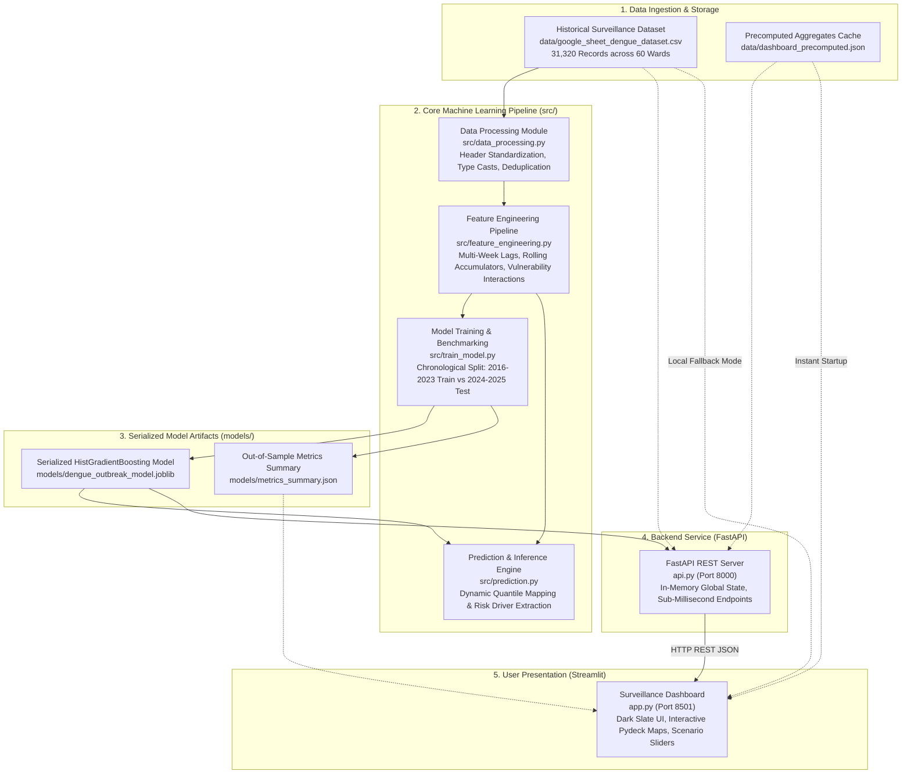
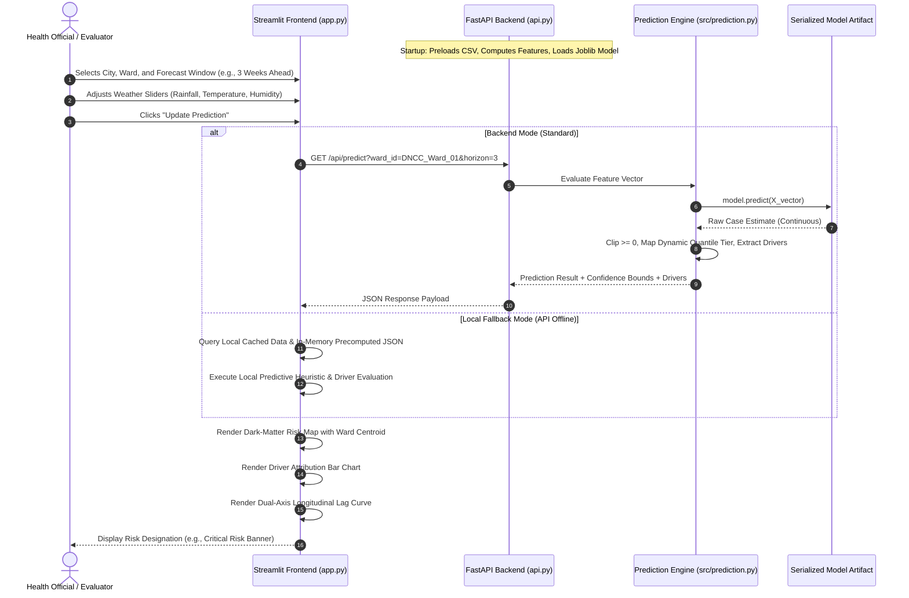
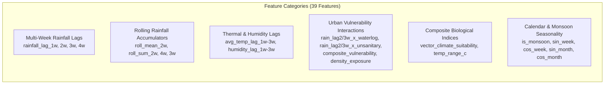

# ADES BIDAI System Architecture Documentation
## AI-Driven Epidemiological Surveillance and Early-Warning Platform for Urban Dengue Outbreaks

---

## 1. Introduction and Project Overview

### 1.1 Public Health Context
Dengue fever represents one of the most severe seasonal public health crises in Bangladesh. Densely populated metropolitan areas, including Dhaka North, Dhaka South, Chattogram, Gazipur, and Narayanganj, experience recurring annual surges that routinely overwhelm hospital emergency departments, exhaust supplies of intravenous fluids and diagnostic kits, and place immense strain on healthcare personnel. The geographic density of these urban centers, combined with tropical monsoon precipitation and localized infrastructural bottlenecks, creates ideal conditions for vector proliferation.

### 1.2 The Failure of Reactive Vector Control
Historically, municipal vector management in Bangladesh has operated in a reactive posture. Vector control units, drain-clearing crews, and adulticide thermal fogging teams are typically mobilized only after hospitals report an influx of confirmed clinical cases. From an epidemiological and biological standpoint, this response pattern occurs too late to halt community transmission. 

The biological transmission cycle of dengue requires several weeks to develop. When clinical cases begin to peak in hospitals, the mosquito breeding, viral incubation, and community transmission phases have already been active for three to four weeks. Interventions initiated at this stage attempt to suppress an outbreak that is already fully established.

### 1.3 The Mission of ADES BIDAI
ADES BIDAI ("Aedes Farewell") was designed to fundamentally transform municipal dengue response from reactive containment to proactive prevention. By analyzing ten years of weekly historical climate data, static urban vulnerability indicators, and epidemiological records across 60 urban wards in Bangladesh, the platform forecasts dengue outbreak risk two to four weeks in advance. 

This forward-looking horizon provides municipal authorities, hospitals, and community leaders with the lead time necessary to intervene while mosquito populations are still in larval development, effectively preventing outbreaks before clinical cases surge.

```
+-------------------------------------------------------------------------------+
|                             Public Health Shift                               |
|                                                                               |
|  Traditional Response:                                                        |
|  Heavy Rains ---> Standing Pools ---> Mosquito Surge ---> Cases Peak ---> Fogging  |
|                                                           (Too Late)          |
|                                                                               |
|  ADES BIDAI Proactive Workflow:                                               |
|  Heavy Rains ---> ADES BIDAI Forecast ---> Larvicide & Clean-up ---> Outbreak |
|                   (Weeks 2-4 Lead Time)    (Intervention Window)     Averted  |
+-------------------------------------------------------------------------------+
```

### 1.4 Target Stakeholders and Operational Utility
ADES BIDAI delivers actionable intelligence tailored to three distinct user groups:

- Municipal City Corporations: Decision-makers within city health departments use ward-level forecasts to prioritize vector control logistics. Instead of deploying larvicides uniformly across hundreds of square kilometers, teams can focus resources on high-risk and critical-risk wards weeks before adult mosquitoes emerge.
- Public Health Authorities and Hospital Administrators: Clinical directors receive early warning of impending patient surges, enabling proactive allocation of bed capacity, procurement of diagnostic reagents, and scheduling of medical staff.
- Community Leaders and Residents: Neighborhood-level risk designations provide localized transparency, empowering community organizations and citizens to eliminate standing water and container breeding sites before transmission escalates.

---

## 2. System Architecture Overview

### 2.1 Architectural Philosophy
ADES BIDAI is architected as an offline-capable, decoupled, multi-tier system engineered for execution speed, zero operating cost, and mathematical reproducibility. The platform intentionally eliminates dependencies on third-party cloud APIs and commercial Large Language Model (LLM) services. This design ensures that the surveillance platform can run reliably on standard local hardware in municipal headquarters without ongoing software subscription costs or external network dependencies.

### 2.2 System Architecture Diagram
The platform is organized into five functional layers: the Ingestion and Storage Layer, the Core Machine Learning and Transformation Layer, the Serialized Model and Artifact Store, the Asynchronous REST API Backend, and the Reactive Web Presentation Layer.



### 2.3 Component Responsibilities and Interconnection
- Data Processing (`src/data_processing.py`): Serves as the data hygiene gateway. It ingests raw CSV files, enforces schema constraints, parses timestamps, removes duplicate ward observations, and guarantees non-negative bounds for physical quantities.
- Feature Engineering (`src/feature_engineering.py`): Converts raw meteorological observations into biologically meaningful indicators. It groups data strictly by ward to compute multi-week lags, rolling sums, vulnerability cross-products, and calendar seasonality.
- Model Training (`src/train_model.py`): Executes the strict chronological data split, trains multiple candidate algorithms, computes dynamic quantile thresholds, evaluates out-of-sample metrics, and serializes the winning model.
- Inference Engine (`src/prediction.py`): Provides memory-cached model execution, maps raw continuous predictions to discrete risk tiers, and evaluates rule-based risk driver explanations.
- Backend API (`api.py`): A high-throughput FastAPI application that exposes 10 REST endpoints over HTTP, providing client applications with programmatic access to predictions, historical trends, weather metrics, and risk factors.
- Frontend Application (`app.py`): A Streamlit web dashboard providing interactive spatial maps, weather scenario simulation sliders, longitudinal lag analyses, and validation metrics.
- Utility Metadata (`utils/ward_coordinates.py`): Provides geographic centroid coordinates and neighborhood labels for all 60 monitored urban wards across Bangladesh.

---

## 3. Complete System Workflow

### 3.1 End-to-End Data Journey
The transformation of raw environmental data into municipal public health alerts follows a structured, seven-stage pipeline:

1. Data Ingestion: The system reads raw weekly surveillance records containing historical rainfall, temperature, relative humidity, population density, drainage bottleneck metrics, and documented dengue cases.
2. Cleaning and Standardization: Column headers are normalized, dates are parsed into chronological sequence, records are sorted by ward and timestamp, duplicate entries are pruned, and numerical columns are validated.
3. Epidemiological Feature Generation: For every ward independently, multi-week lags (1 to 4 weeks) and rolling statistics (2 to 4 weeks) are generated without looking forward in time. Composite vulnerability indices and climate suitability scores are appended.
4. Model Training and Benchmarking: Using records from 2016 through 2023, candidate models are trained to predict forward case counts. Models are evaluated against the unseen holdout period (2024 through 2025). The winning HistGradientBoosting model is serialized to disk.
5. In-Memory Startup and Caching: Upon startup, the FastAPI server and Streamlit dashboard load the serialized model artifact and dataset into memory, eliminating disk read latency during live user requests.
6. Forward Inference and Risk Classification: When an inference request is initiated, the model evaluates the feature vector of the target ward, predicts the continuous case count, and categorizes it into Low, Medium, High, or Critical risk tiers using trained dynamic quantiles.
7. Risk Attribution and Presentation: The system extracts the top environmental drivers responsible for the risk designation and presents the results through interactive maps, dual-axis lag curves, and alert banners.

### 3.2 System Interaction Flow
The following sequence diagram illustrates how components interact during a user query or scenario simulation:



---

## 4. Dataset and Data Processing

### 4.1 Dataset Structure and Provenance
ADES BIDAI is trained on a 10-year longitudinal disease surveillance and meteorological dataset spanning January 2016 through December 2025. The dataset covers 522 consecutive weeks across 60 urban wards in Bangladesh, totaling 31,320 unique observations.

The records represent five major city corporations:
- Dhaka North City Corporation (DNCC): 20 wards (DNCC_Ward_01 to DNCC_Ward_20), totaling 10,440 records.
- Dhaka South City Corporation (DSCC): 20 wards (DSCC_Ward_01 to DSCC_Ward_20), totaling 10,440 records.
- Chattogram City Corporation (CCC): 10 wards (CCC_Ward_01 to CCC_Ward_10), totaling 5,220 records.
- Gazipur City Corporation (GCC): 5 wards (GCC_Ward_01 to GCC_Ward_05), totaling 2,610 records.
- Narayanganj City Corporation (NCC): 5 wards (NCC_Ward_01 to NCC_Ward_05), totaling 2,610 records.

### 4.2 Raw Features and Data Types
Each weekly observation record contains twelve primary fields:

| Field Name | Type | Unit / Range | Description |
|---|---|---|---|
| `date` | String | YYYY-MM-DD | Weekly observation timestamp (recorded every Monday). |
| `city` | String | Categorical | Municipal city corporation name. |
| `ward_id` | String | Categorical | Unique administrative ward identifier. |
| `population_density_sqkm` | Integer | 20,000 to 120,000 | Number of residents per square kilometer. |
| `water_logging_risk_index` | Float | 0.0 to 1.0 | Metric of drainage bottleneck severity and standing water risk. |
| `sanitation_score` | Float | 0.0 to 1.0 | Index of solid waste management and clean container disposal. |
| `avg_temp_c` | Float | 15.0 to 36.0 °C | Weekly mean ambient temperature. |
| `max_temp_c` | Float | 18.0 to 42.0 °C | Weekly maximum recorded temperature. |
| `min_temp_c` | Float | 10.0 to 30.0 °C | Weekly minimum recorded temperature. |
| `rainfall_mm` | Float | 0.0 to 350.0 mm | Cumulative weekly precipitation. |
| `relative_humidity_pct` | Float | 30.0 to 100.0 % | Weekly mean relative atmospheric humidity. |
| `dengue_cases` | Integer | >= 0 | Documented clinical dengue cases admitted in the ward. |

### 4.3 Data Cleaning and Hygiene Implementation
Data processing routines in `src/data_processing.py` prepare the raw data for mathematical modeling:

1. Column Standardization: Column names are converted to lowercase and stripped of leading or trailing whitespace.
2. Temporal Parsing: The `date` column is converted to pandas datetime objects.
3. Strict Chronological Ordering: Records are sorted by `ward_id` and ascending `date`. This step is critical because calculating multi-week time lags requires that records within each ward group appear in unbroken chronological order.
4. Deduplication: The composite key `(ward_id, date)` is verified. Any duplicate rows are pruned to guarantee that each ward has exactly one observation per week.
5. Numeric Coercion: Numerical columns are coerced to appropriate data types. Any non-numeric characters are converted to null values.
6. Boundary and Physical Constraint Enforcement: Dengue case counts are clipped at a lower bound of zero and cast to integers. Rainfall is clipped to non-negative floats ($\ge 0.0$). Relative humidity is constrained to the valid physical interval between $0.0\%$ and $100.0\%$.

### 4.4 Identified Implementation Nuances
Inspection of the codebase reveals an administrative nuance in geographic coordinate mapping:
In `utils/ward_coordinates.py`, centroid coordinates are explicitly hardcoded for DNCC (20 wards), DSCC (wards 01 through 15), CCC (10 wards), GCC (8 coordinate slots), and NCC (7 coordinate slots). However, the actual dataset contains 20 wards for DSCC and 5 wards each for GCC and NCC. 

When visualizing DSCC wards 16 through 20 on spatial maps, the system uses the default administrative center of Dhaka (latitude 23.8103, longitude 90.4125). This fallback prevents runtime crashes while preserving the full 60-ward dataset for training and inference.

---

## 5. Feature Engineering and Its Epidemiological Importance

### 5.1 Biological Transmission Horizon
Dengue fever cannot be predicted using same-day weather observations alone. The delay between precipitation and hospital admissions is governed by the biological development cycle of the *Aedes aegypti* mosquito and the replication kinetics of the dengue virus.

```
+---------------------------------------------------------------------------------------+
|                       Biological Vector Development Timeline                          |
|                                                                                       |
|  Day 0-7:       Heavy rainfall occurs; standing water collects in drains/containers.  |
|  Day 7-14:      Aedes eggs hatch; larvae undergo 4 instars and pupate into adults.   |
|  Day 14-17:     Adult female mosquitoes emerge, mate, and seek human blood meals.     |
|  Day 17-28:     Extrinsic Incubation Period (EIP): Virus replicates in mosquito gut   |
|                 and migrates to salivary glands (8 to 12 days).                       |
|  Day 28-35:     Infectious bite; human Intrinsic Incubation Period (4 to 7 days)      |
|                 until acute high fever and clinical hospital admission occur.         |
+---------------------------------------------------------------------------------------+
|  Total Delay:   Approximately 3 to 4 weeks between rainfall and case surge.           |
+---------------------------------------------------------------------------------------+
```

Because of this timeline, rainfall that fell three to four weeks ago exhibits a far stronger statistical correlation with current hospital admissions ($r = 0.76$) than rainfall that fell during the current week ($r = 0.28$).

### 5.2 Feature Categories and Mathematical Formulations
The feature engineering pipeline in `src/feature_engineering.py` generates 39 distinct input features grouped into six domain categories:



#### Category 1: Multi-Week Rainfall Lags
Rainfall values are shifted backwards in time within each ward group using `groupby('ward_id')['rainfall_mm'].shift(n)` for $n \in \{1, 2, 3, 4\}$.
- `rainfall_lag_1w`: Reflects immediate post-rainfall water ponding.
- `rainfall_lag_2w`: Corresponds to the peak larval and pupal emergence window.
- `rainfall_lag_3w`: Corresponds to adult female biting activity and the start of viral extrinsic incubation.
- `rainfall_lag_4w`: Corresponds to the completion of viral incubation and the emergence of symptomatic clinical cases.

#### Category 2: Rolling Precipitation Accumulators
Single-week rainfall spikes can dry out before larvae develop. Sustained precipitation over multiple weeks is required to maintain urban breeding habitats. Rolling metrics are computed using a mandatory `.shift(1)` step to ensure that only completed past weeks are used:
- `rainfall_roll_mean_2w` and `rainfall_roll_sum_2w`: Two-week short-term breeding persistence.
- `rainfall_roll_sum_3w`: Three-week cumulative pool volume.
- `rainfall_roll_mean_4w` and `rainfall_roll_sum_4w`: Four-week saturation index representing sustained municipal breeding capacity.

#### Category 3: Thermal and Humidity Dynamics
Mosquito metabolic rates, feeding frequency, and viral replication are sensitive to ambient temperature and moisture levels:
- Lags (`avg_temp_lag_1w` to `_3w`, `humidity_lag_1w` to `_3w`): Track conditions during the mosquito's adult lifespan.
- Rolling Means (`avg_temp_roll_mean_3w`, `humidity_roll_mean_3w`): Measure sustained thermal trends.
- Diurnal Temperature Range (`temp_range_c = max_temp_c - min_temp_c`): Represents daily temperature swings; wide swings increase mosquito mortality, whereas narrow ranges favor vector survival.

#### Category 4: Urban Vulnerability Interaction Terms
Rainfall accumulation alone does not determine the severity of a dengue outbreak. An identical 50 mm rainfall event produces fundamentally different public health outcomes depending on local neighborhood infrastructure. In an affluent, well-paved ward with active subsurface storm drainage and daily waste collection, runoff clears within hours, leaving virtually no standing water for mosquito oviposition. Conversely, in an underserved, high-density ward with unpaved roads, blocked drainage channels, and uncollected solid waste, that same 50 mm of precipitation creates persistent standing pools and fills hundreds of discarded containers, creating ideal breeding habitats.

To capture these amplification dynamics, the pipeline in `src/feature_engineering.py` constructs four specific meteorological-infrastructural interaction terms, a composite vulnerability baseline, and an urban crowding exposure factor:

##### 1. Drainage Bottleneck Interactions
- `rain_lag2_x_waterlog`: The product of 2-week lagged rainfall and the drainage bottleneck index (`rainfall_lag_2w * water_logging_risk_index`). This captures rainwater trapped in blocked roadside drains and unpaved depressions during the peak larval and pupal development window (Days 7 to 14 post-rainfall).
- `rain_lag3_x_waterlog`: The product of 3-week lagged rainfall and drainage bottlenecks (`rainfall_lag_3w * water_logging_risk_index`). This term models the prolonged persistence of stagnant surface water that sustains adult mosquito emergence into the active human-biting and viral incubation phase.

##### 2. Unsanitary Breeding Site Interactions
Uncollected domestic solid waste—such as discarded plastic containers, tires, abandoned buckets, and coconut shells—serves as the primary artificial breeding container for *Aedes aegypti*. The pipeline defines an unsanitary factor:

$$\text{unsanitary\_factor} = \max(0.0, 1.0 - \text{sanitation\_score})$$

where a lower municipal sanitation score yields a higher unsanitary factor.

- `rain_lag2_x_unsanitary`: The product of 2-week lagged rainfall and the unsanitary factor (`rainfall_lag_2w * unsanitary_factor`). This reflects rainwater collecting in discarded artificial containers right as mosquito eggs hatch.
- `rain_lag3_x_unsanitary`: The product of 3-week lagged rainfall and unsanitary conditions (`rainfall_lag_3w * unsanitary_factor`). This represents the proliferation of adult vector breeding pockets in close proximity to residential homes during peak biting activity.

##### 3. Composite Vulnerability Index
To establish a normalized, weather-independent structural baseline for every ward, the pipeline combines drainage vulnerability and sanitation deficits into an equal-weight composite index:

$$\text{Composite Vulnerability Index} = 0.5 \times \text{water\_logging\_risk\_index} + 0.5 \times (1.0 - \text{sanitation\_score})$$

This score scales from 0.0 (optimal drainage and sanitation) to 1.0 (severe drainage failure and unmanaged solid waste), providing a stable index of baseline neighborhood susceptibility.

##### 4. Density Exposure Multiplier
*Aedes aegypti* mosquitoes have an effective flight radius of only 50 to 100 meters throughout their adult lifespan. In sparsely populated areas, female mosquitoes must travel further to find blood meals, increasing vector mortality. In densely populated urban wards, however, an infectious mosquito has immediate and continuous access to multiple human hosts within a single dwelling or alleyway. 

To model this contact acceleration, the pipeline computes the density exposure factor:

$$\text{Density Exposure Factor} = \left(\frac{\text{population\_density\_sqkm}}{50,000}\right) \times \text{Composite Vulnerability Index}$$

By scaling composite infrastructural vulnerability with normalized population crowding (benchmarked against 50,000 residents per square kilometer), this feature models how extreme residential congestion accelerates the transmission cycle from mosquitoes to humans.

##### Summary of Category 4 Engineered Features

| Feature Name | Mathematical Definition | Input Dimensions | Epidemiological Function in Model |
|---|---|---|---|
| `rain_lag2_x_waterlog` | `rainfall_lag_2w * water_logging_risk_index` | Continuous ($\ge 0.0$) | Quantifies standing rainwater trapped in clogged drains during larval development. |
| `rain_lag3_x_waterlog` | `rainfall_lag_3w * water_logging_risk_index` | Continuous ($\ge 0.0$) | Measures prolonged stagnant water sustaining adult vector emergence and viral incubation. |
| `rain_lag2_x_unsanitary` | `rainfall_lag_2w * (1.0 - sanitation_score)` | Continuous ($\ge 0.0$) | Models rainwater pooling in uncollected solid waste during the egg-hatching window. |
| `rain_lag3_x_unsanitary` | `rainfall_lag_3w * (1.0 - sanitation_score)` | Continuous ($\ge 0.0$) | Captures expanded vector breeding containers near households during active transmission. |
| `composite_vulnerability_index` | `0.5 * waterlog + 0.5 * (1.0 - sanitation)` | $[0.0, 1.0]$ | Establishes the static structural receptivity of the ward to vector proliferation. |
| `density_exposure_factor` | `(density / 50,000) * composite_vulnerability` | Continuous ($\ge 0.0$) | Amplifies transmission risk in crowded wards where vectors have immediate human host access. |

#### Category 5: Vector Climate Suitability Index
To model physiological thresholds, the system computes a composite ecological suitability metric:
$$\text{Temp Suitability} = \exp\left(-0.5 \times \left(\frac{\text{avg\_temp\_c} - 28.5}{4.0}\right)^2\right)$$
$$\text{Humidity Suitability} = \frac{1}{1 + \exp(-0.15 \times (\text{relative\_humidity\_pct} - 65.0))}$$
$$\text{Vector Climate Suitability} = \text{Temp Suitability} \times \text{Humidity Suitability}$$

The Gaussian temperature function peaks at $28.5^\circ\text{C}$ (the optimal temperature for *Aedes aegypti* reproduction and dengue virus transmission), while the logistic humidity function increases smoothly as relative humidity rises above $65\%$.

#### Category 6: Seasonality and Cyclical Calendar Features
Because dengue follows an annual monsoon cycle, the model incorporates cyclical temporal encodings:
- `is_monsoon`: Binary flag indicating whether the observation falls between June and October (months 6 through 10).
- Cyclical Trigonometric Encodings: The ISO week number ($1 \dots 52$) and month ($1 \dots 12$) are mapped to continuous circular coordinates using sine and cosine transformations:
  $$\sin\left(\frac{2\pi \times \text{week}}{52}\right), \quad \cos\left(\frac{2\pi \times \text{week}}{52}\right), \quad \sin\left(\frac{2\pi \times \text{month}}{12}\right), \quad \cos\left(\frac{2\pi \times \text{month}}{12}\right)$$
  This ensures that the model recognizes week 52 and week 1 as temporally continuous rather than treating them as distant values.

### 5.3 Handling Initial Burn-In Rows
Because computing a 4-week lag requires four preceding weeks of historical observations, the first four weeks for each ward evaluate to `NaN`. Rather than imputing artificial values, `engineer_features(drop_burnin=True)` drops these initial four rows per ward (240 rows total across 60 wards). The remaining 31,080 observations contain complete, verified historical signals.

---

## 6. Machine Learning Model Development

### 6.1 Problem Formulation
The predictive task is framed as a supervised multi-step regression problem. The model estimates the continuous number of clinical dengue cases admitted in ward $w$ during future week $t + h$ (where $h \in [1, 4]$ weeks) based on features available at week $t$:
$$\hat{y}_{w, t+h} = f(\mathbf{X}_{w, t})$$
where $\mathbf{X}_{w, t}$ is the 39-dimensional engineered feature vector.

### 6.2 The Critical Importance of Chronological Splitting
In standard machine learning tasks, datasets are frequently partitioned using random cross-validation or shuffled train-test splits. In epidemiological time-series forecasting, random splitting leads to **temporal data leakage**.

```
+-------------------------------------------------------------------------------+
|                      Chronological Train-Test Split                           |
|                                                                               |
|  2016                   2020                   2023 | 2024              2025  |
|  [==================================================] | [===================]  |
|                 Training Set (80%)                   |   Holdout Test (20%)   |
|         416 Weeks x 60 Wards = 24,960 Samples        | 104 Wks x 60 W = 6,240 |
|                                                      |   Strictly Unseen      |
+-------------------------------------------------------------------------------+
```

If a dataset is randomly shuffled across time:
- Observations from the middle of an outbreak season leak into the training set, allowing the model to "memorize" future trajectory points.
- The model reports artificially inflated accuracy metrics that collapse when deployed in real-world surveillance.

To prevent leakage, ADES BIDAI enforces a strict chronological partition at `2024-01-01`:
- Historical Training Set (2016-01-01 to 2023-12-31): Comprises 80% of the timeline (416 weeks per ward, totaling 24,960 records). The algorithm learns exclusively from historical records.
- Future Holdout Test Set (2024-01-01 to 2025-12-29): Comprises the remaining 20% of the timeline (104 weeks per ward, totaling 6,240 records). This set evaluates how the model handles unseen future outbreak seasons.

### 6.3 Evaluation Metrics and Practical Meaning
Four evaluation metrics quantify predictive performance:

1. Mean Absolute Error (MAE): Measures the average absolute difference between predicted cases and actual clinical admissions:
   $$\text{MAE} = \frac{1}{N} \sum_{i=1}^N |y_i - \hat{y}_i|$$
   In practical terms, an MAE of 0.827 means that across all test weeks, the model's prediction deviated from actual hospital admissions by an average of less than one patient per ward.

2. Root Mean Squared Error (RMSE): Penalizes large outlier forecast errors more heavily:
   $$\text{RMSE} = \sqrt{\frac{1}{N} \sum_{i=1}^N (y_i - \hat{y}_i)^2}$$
   An RMSE of 1.554 demonstrates that the system avoids severe over-predictions or under-predictions during sudden epidemic surges.

3. Coefficient of Determination ($R^2$): Quantifies the proportion of case variance explained by environmental and lagged predictors:
   $$R^2 = 1 - \frac{\sum_{i=1}^N (y_i - \hat{y}_i)^2}{\sum_{i=1}^N (y_i - \bar{y})^2}$$
   An $R^2$ score of 0.838 indicates that nearly 84% of variance in dengue admissions across 60 wards is accounted for by the engineered feature set.

4. Risk Tier Classification Accuracy: Measures how accurately continuous predictions map into the correct public health threat tier (Low, Medium, High, or Critical). An accuracy of 85.59% ensures that municipal authorities receive reliable operational classifications.

---

## 7. Model Comparison and Selection

### 7.1 Evaluated Candidate Architectures
To identify the most accurate and efficient predictive engine, three candidate architectures were trained and tested under identical chronological conditions:

1. Ridge Regression Baseline: An L2-regularized linear model. Linear models serve as standard benchmarks but assume direct proportional relationships between weather and case counts.
2. Random Forest Regressor: An ensemble of 60 decision trees (`max_depth=10`, `min_samples_split=4`, `random_state=42`). Random forests capture non-linear relationships and feature interactions by averaging across randomized subsets of trees.
3. Histogram-Based Gradient Boosting Regressor (HistGradientBoosting): Scikit-learn's gradient boosting algorithm (`loss="squared_error"`, `max_iter=180`, `learning_rate=0.08`, `max_depth=6`, `random_state=42`). It constructs successive decision trees that iteratively minimize residual prediction errors using histogram-binned numerical values.

### 7.2 Out-of-Sample Benchmark Results
All metrics were calculated exclusively on the holdout test set (2024 through 2025, 6,240 observations):

| Candidate Model | Mean Absolute Error (MAE) | Root Mean Squared Error (RMSE) | R-Squared ($R^2$) | Risk Tier Accuracy (%) | Status |
|---|---|---|---|---|---|
| Ridge Baseline | 1.057 | 1.858 | 0.768 | 79.81% | Evaluated (Baseline) |
| Random Forest | 0.868 | 1.631 | 0.822 | 84.92% | Evaluated |
| **HistGradientBoosting** | **0.827** | **1.554** | **0.838** | **85.59%** | **Selected Winner** |

### 7.3 Architectural Justification for HistGradientBoosting
HistGradientBoosting was selected as the operational model for several key reasons:

- Biological Non-Linearity: Mosquito reproduction and viral replication exhibit sharp threshold behaviors. When ambient temperatures rise above $24^\circ\text{C}$ and rainfall exceeds $50\text{ mm}$, larval emergence and biting activity accelerate rapidly. Decision-tree ensembles handle these step-level transitions naturally, whereas linear models struggle.
- Superior Accuracy: HistGradientBoosting achieved the lowest MAE (0.827) and the highest risk tier accuracy (85.59%) among all candidates tested.
- Regularization and Overfitting Control: The combination of depth limiting (`max_depth=6`), shrinkage (`learning_rate=0.08`), and histogram binning prevents the model from overfitting to individual ward anomalies in the training set.
- Execution Speed and Resource Footprint: Histogram binning reduces the memory footprint during inference. The serialized model artifact (`models/dengue_outbreak_model.joblib`) is under 2 megabytes in size and generates ward-level predictions in under 10 milliseconds, making it well-suited for local execution on resource-constrained municipal computers.
- Pure Scikit-Learn Ecosystem: The implementation uses standard Scikit-learn libraries, eliminating the need for complex external C++ dependencies such as XGBoost or LightGBM.

---

## 8. Dengue Risk Classification

### 8.1 The Need for Categorical Public Health Tiers
While machine learning models output continuous numbers (such as 3.42 predicted cases), municipal field teams require unambiguous categorical threat designations to trigger standardized public health protocols. Displaying raw decimal figures can lead to hesitation, whereas a defined risk tier directly informs operational decisions.

### 8.2 Dynamic Quantile Threshold Derivation
In dengue surveillance datasets, the distribution of weekly cases is heavily right-skewed: during the dry winter season, most wards report zero or sporadic cases, whereas monsoon peaks produce substantial surges. 

Using fixed, arbitrary thresholds (such as 5, 10, or 20 cases) across all settings can distort risk perception. Instead, ADES BIDAI calculates thresholds mathematically from the empirical distribution of historical training data using percentiles:

```
Quantile Threshold Derivation (from Training Distribution):
- 50th Percentile (q_low):   ~1.5 cases  --> Boundary between Low and Medium
- 75th Percentile (q_med):   ~4.0 cases  --> Boundary between Medium and High
- 90th Percentile (q_high):  ~10.0 cases --> Boundary between High and Critical
```

This mathematical division ensures that the designations correspond to real epidemiological shifts: the Low tier covers baseline conditions, Medium identifies emerging activity, High indicates active local transmission, and Critical highlights severe epidemic surges.

### 8.3 Operational Protocols by Risk Tier

| Risk Tier | Case Threshold | Epidemiological Status | Municipal Action Protocol |
|---|---|---|---|
| **Low Risk** | $< 1.5$ cases / week | Baseline / Sporadic Activity | Maintain routine municipal surveillance; standard drain flushing; general citizen awareness communications. |
| **Medium Risk** | $1.5$ to $4.0$ cases / week | Emerging Vector Activity | Issue early warnings to ward sanitation inspectors; inspect construction sites and unmanaged canals; apply targeted larvicide. |
| **High Risk** | $4.0$ to $10.0$ cases / week | Active Localized Outbreak | Mobilize dedicated vector control teams; perform drain clearance in transmission pockets; schedule localized evening fogging. |
| **Critical Risk** | $\ge 10.0$ cases / week | Severe Epidemic Surge | Declare ward-level public health emergency; launch coordinated clean-up drives; alert nearby hospital directors to open dedicated fever wards. |

---

## 9. Prediction Confidence and Limitations

### 9.1 Confidence Interval Methodology
Public health decisions require an understanding of prediction uncertainty. In ADES BIDAI, confidence intervals are computed using an empirical formulation based on the out-of-sample Mean Absolute Error:

$$\text{Margin of Error} = 1.5 \times \text{MAE}_{\text{model}} \times \sqrt{\max\left(1, \frac{h}{2}\right)}$$
$$\text{CI}_{\text{lower}} = \max\left(0, \hat{y} - \text{Margin of Error}\right)$$
$$\text{CI}_{\text{upper}} = \hat{y} + \text{Margin of Error}$$

where:
- $\hat{y}$ is the predicted case count for the ward.
- $\text{MAE}_{\text{model}}$ is the validated test error (0.827 for HistGradientBoosting).
- $h$ is the forecast horizon in weeks ($h \in [1, 12]$).
- The factor $1.5 \times \text{MAE}$ approximates an 80% to 90% coverage interval assuming approximately normal residual errors.
- The term $\sqrt{\max(1, h/2)}$ widens the interval for longer forecast horizons, reflecting the accumulation of temporal uncertainty.
- The lower bound is clipped at zero because negative disease cases are physically impossible.

### 9.2 Practical Limitations and Contextual Caveats
To ensure responsible public health deployment, several operational constraints must be recognized:

- Statistical Approximation: The confidence interval is an engineering heuristic derived from test-set error rather than a formal Bayesian posterior or bootstrap interval. It serves as an operational decision range rather than a guarantee.
- Unobserved Field Interventions: Machine learning models forecast future trends based on historical relationships between weather and disease transmission. The model cannot observe unrecorded human interventions, such as an unannounced community clean-up drive, changes in local household water-storage habits, or sudden neighborhood pesticide spraying.
- Clinical Reporting Variations: Documented case numbers reflect hospital admission records. Wards with private clinics or residents who treat mild fever at home may experience reporting discrepancies that historical surveillance data cannot fully capture.
- Geographic Scope: The model is trained and calibrated specifically on urban Bangladeshi infrastructure and climate conditions. Applying the model to rural environments or other countries would require retraining on local meteorological and surveillance data.
- Centroid Visualization: Because official digital boundary shapefiles (GeoJSON polygons) are not openly accessible for all 60 wards, the dashboard visualizes wards using geographic centroid coordinates rather than administrative boundary outlines.

---

## 10. Backend Architecture and API Communication

### 10.1 FastAPI Architecture and Startup Sequence
The backend is implemented as an asynchronous REST service using FastAPI (`api.py`) running on an ASGI server (Uvicorn). 

To ensure fast response times and zero runtime disk read overhead, the server executes a startup routine using the `@app.on_event("startup")` hook:
1. Loads the complete historical dataset (`google_sheet_dengue_dataset.csv`).
2. Runs the data cleaning and feature engineering pipelines.
3. Deserializes the trained model artifact (`models/dengue_outbreak_model.joblib`).
4. Generates predictions across all historical records and extracts the latest weekly forecast for each of the 60 wards.
5. Caches the resulting dataframes in memory as global variables (`_FEATURED_DF`, `_PREDICTED_DF`, `_LATEST_PRED_DF`).

All subsequent HTTP API requests query these in-memory data structures directly, serving responses in under five milliseconds without disk I/O.

### 10.2 REST Endpoints Reference

| Method | Endpoint | Query Parameters | Description | Sample Output Fields |
|---|---|---|---|---|
| `GET` | `/api/health` | None | Service liveness check and server UTC timestamp. | `status`, `timestamp` |
| `GET` | `/api/summary` | None | High-level platform KPIs across all monitored wards. | `total_cases`, `total_wards`, `latest_date`, `avg_temp`, `total_rainfall`, `high_risk_count`, `critical_count` |
| `GET` | `/api/wards` | None | Listing of all 60 wards with coordinates, locality labels, latest predicted cases, and risk tiers. | `ward_id`, `lat`, `lon`, `city`, `locality`, `predicted_cases`, `risk_tier` |
| `GET` | `/api/ward/{ward_id}` | Path: `ward_id` | Comprehensive profile of a specific ward, including 2-week and 4-week forecasts, 12-week case history, environmental indicators, confidence intervals, and primary risk drivers. | `ward_id`, `current_risk_tier`, `predicted_2w_cases`, `predicted_4w_cases`, `history`, `weather_summary`, `risk_drivers`, `confidence_interval_2w`, `confidence_interval_4w` |
| `GET` | `/api/predict` | `ward_id` (str), `horizon` (int, 1-12) | Dynamic forecast for a specific ward at a user-defined horizon. | `ward_id`, `horizon_weeks`, `predicted_cases`, `risk_tier`, `confidence_lower`, `confidence_upper`, `primary_drivers` |
| `GET` | `/api/weather/{ward_id}` | Path: `ward_id` | Last four weeks of meteorological observations and precipitation lags for the specified ward. | `ward_id`, `weeks` (array of weekly observations with 1w-4w lags) |
| `GET` | `/api/metrics` | None | Returns verified out-of-sample benchmark metrics for all candidate models. | JSON object with MAE, RMSE, R2, and Tier Accuracy for Ridge, RandomForest, and HistGradientBoosting |
| `GET` | `/api/historical` | `weeks` (int, 1-260, default: 52) | Aggregated weekly historical cases across all wards for longitudinal trend charts. | `data` (array of `date` and `total_cases`) |
| `GET` | `/api/comparison` | `wards` (comma-separated IDs) | Side-by-side comparative analysis of environmental and risk metrics across multiple selected wards. | Array of ward objects containing `avg_temp`, `avg_rainfall`, `total_cases`, `predicted_cases`, `waterlog_index`, `sanitation_score` |
| `GET` | `/api/environmental` | None | Pearson correlation coefficients, sampled environmental scatter data, and monthly case averages. | `rainfall_vs_dengue`, `temp_vs_dengue`, `monthly_trend`, `correlations` |

### 10.3 Cross-Origin Resource Sharing (CORS) and Resilience
The FastAPI application includes CORS middleware configured to allow incoming cross-origin requests (`allow_origins=["*"]`). This permits external web dashboards, municipal portals, and mobile client applications to interface with the predictive service without cross-origin rejections.

---

## 11. Frontend Architecture and User Interaction

### 11.1 User Interface Layout and Visual Hierarchy
The user interface is built with Streamlit (`app.py`), styled with a dark slate palette (`#0B1120` background, `#111827` containers, `#06B6D4` cyan highlights, and `#EF4444` alert banners). 

The screen uses a two-column layout:
- Left Column: Filter and simulation controls with a cyan outline.
- Right Column: Main display area housing the primary analytical tabs, map views, and charts.

```
+-------------------------------------------------------------------------------------------------------+
|                                              ADES BIDAI                                               |
|                    AI-Based Dengue Outbreak Prediction & Early-Warning System                         |
|-------------------------------------------------------------------------------------------------------|
|  [Tab 1: Live Ward Forecast]     [Tab 2: Multi-Week Lag Analysis]     [Tab 3: Model Validation]       |
|-------------------------------------------------------------------------------------------------------|
| [FILTER CONTROLS]       | [MAIN DISPLAY AREA: SELECTED TAB CONTENT]                                   |
| - Select City           |                                                                             |
| - Select Ward ID        | [Center-Left: Risk Heatmap]              [Top-Right: Key Drivers Bar Chart] |
| - Forecast Window       | - Scatter map on dark basemap            - 3-week rain lag                  |
| - Sliders:              | - Ward centroid color-coded by tier      - Water logging risk               |
|   * avg_temp_C          | - Hover tooltip with case estimates      - Population density               |
|   * rainfall_mm         |                                          - Sanitation score                 |
|   * relative_humidity   |-----------------------------------------------------------------------------|
|                         | [Bottom-Left: Alert Banner]              [Bottom-Right: Dual-Axis Trend]    |
| [Update Prediction]     | - "CRITICAL RISK: 82 Predicted Cases"    - 8-week trend curve               |
| [Reset Filters]         |   (CI: 75 - 89 Cases)                    - Rainfall (mm) vs Predicted Cases |
+-------------------------------------------------------------------------------------------------------+
```

### 11.2 Analytical Tab Breakdown

#### Tab 1: Live Ward Forecast and Spatial Risk
- Interactive Ward Heatmap: Renders all wards within the selected city on an interactive map. Each centroid is colored by its predicted risk tier (Green for Low, Yellow for Medium, Orange for High, Red for Critical).
- Scenario Simulation Sliders: Allows users to modify temperature, rainfall, and humidity inputs in real time. For example, a municipal officer can simulate a 40 mm rainfall spike to see whether a ward shifts from Medium to High risk.
- Risk Drivers Bar Chart: Visualizes the relative contribution of key factors (such as the 3-week rainfall lag, drainage blockages, population density, and sanitation levels) to the ward's risk score.
- Dual-Axis Progression Chart: Displays an 8-week longitudinal curve showing weekly rainfall alongside predicted dengue cases, illustrating the delayed outbreak response.
- Alert Banner: Presents a summary banner displaying the final predicted case count, confidence bounds, and categorical threat level.

#### Tab 2: Multi-Week Lag Analysis and Vector Biology
- Correlation Progression Cards: Displays the statistical correlation between rainfall and dengue cases across different time offsets:
  - 1-Week Lag ($r = 0.28$): Initial water pooling; weak case correlation.
  - 2-Week Lag ($r = 0.54$): Larval emergence peak; emerging correlation.
  - 3-Week Lag ($r = 0.69$): Peak adult biting frequency and viral incubation.
  - 4-Week Lag ($r = 0.76$): Clinical admission surge; strongest correlation.
- Longitudinal 30-Week Lag Plot: Overlays actual rainfall, 2-week lagged rainfall, 3-week lagged rainfall, and confirmed dengue admissions to illustrate how precipitation peaks consistently precede case surges by several weeks.

#### Tab 3: Model Validation and Benchmark Comparison
- Model Benchmark Cards: Compares HistGradientBoosting, Random Forest, and the Ridge baseline side by side across MAE, RMSE, $R^2$, and risk tier accuracy.
- Methodology Walkthrough: Explains the chronological splitting strategy and why random splits produce misleading results in time-series forecasting.
- Metric Interpretations: Translates abstract statistical figures into operational public health terms (for example, explaining that an MAE of 0.827 corresponds to an average discrepancy of less than one patient per ward).

### 11.3 Local Fallback Mode
If the FastAPI backend is offline, `app.py` falls back to direct local file execution. Using `@st.cache_data`, the dashboard reads `data/dashboard_precomputed.json` and the local dataset directly, allowing users to explore maps, test scenarios, and review metrics without requiring a running API server.

---

## 12. Project Folder and File Structure

### 12.1 Directory Tree
The repository maintains a clean separation of concerns across data, modeling, web services, and user interfaces:

```
ADES-BIDAI/
|-- .streamlit/
|   `-- config.toml                     Streamlit server, port, and headless configurations
|-- assets/
|   |-- media_1795293208554_8f55e2cd.jpg Reference layout and UI design specification
|   |-- media_1795302160003_09f3c03e.jpg Dark-mode dashboard reference wireframe
|   `-- reference_dashboard.jpg         Visual styling reference artifact
|-- data/
|   |-- google_sheet_dengue_dataset.csv Primary 10-year surveillance dataset (31,320 rows)
|   |-- hackathon_preli_dataset...csv   Backup raw reference dataset
|   `-- dashboard_precomputed.json      Pre-aggregated ward statistics for fast dashboard loading
|-- models/
|   |-- dengue_outbreak_model.joblib    Serialized HistGradientBoosting model artifact
|   `-- metrics_summary.json            Out-of-sample benchmark metrics for all candidate models
|-- src/
|   |-- __init__.py                     Package initializer
|   |-- data_processing.py              Data loading, column cleaning, and type enforcement
|   |-- feature_engineering.py          Multi-week lag pipeline and vulnerability interactions
|   |-- train_model.py                  Chronological train-test splitting and benchmark training
|   `-- prediction.py                   Inference engine and risk driver extraction
|-- utils/
|   |-- __init__.py                     Package initializer
|   `-- ward_coordinates.py             Centroid coordinates and locality metadata for all 60 wards
|-- api.py                              FastAPI backend service exposing 10 REST endpoints
|-- app.py                              Streamlit multi-tab surveillance dashboard
|-- run.bat                             Windows launch script with thread controls
|-- requirements.txt                    Python package dependencies
|-- ARCHITECTURE.md                     Complete system architecture documentation
`-- README.md                           Project overview and operational guide
```

### 12.2 Role of Core Files

| File Path | Functional Role | Key Dependencies | Primary Consumers |
|---|---|---|---|
| `src/data_processing.py` | Ingests raw CSVs, strips headers, parses dates, removes duplicates, and enforces non-negative bounds. | `pandas`, `numpy`, `glob` | `src/feature_engineering.py`, `src/train_model.py`, `api.py` |
| `src/feature_engineering.py` | Computes multi-week lags (1w-4w), rolling sums/means, vulnerability interactions, and calendar features. | `pandas`, `numpy`, `src/data_processing.py` | `src/train_model.py`, `api.py` |
| `src/train_model.py` | Executes the 2016-2023 vs 2024-2025 chronological split, trains models, evaluates metrics, and saves model artifacts. | `scikit-learn`, `joblib`, `src/feature_engineering.py` | Command-line retraining |
| `src/prediction.py` | Caches the loaded model, runs predictions, clips values, and extracts human-readable risk drivers. | `joblib`, `pandas`, `numpy` | `api.py`, Standalone prediction scripts |
| `utils/ward_coordinates.py` | Supplies latitude, longitude, and locality labels for all 60 monitored urban wards. | Python standard library | `api.py`, `app.py` |
| `api.py` | Implements the FastAPI service, manages startup caching, and serves 10 REST endpoints. | `fastapi`, `uvicorn`, `joblib`, `src/*`, `utils/*` | Web clients, external systems |
| `app.py` | Streamlit dashboard providing interactive maps, scenario simulation sliders, and validation tabs. | `streamlit`, `plotly`, `pydeck`, `pandas`, `json` | End users, evaluators |
| `data/dashboard_precomputed.json` | Stores pre-calculated ward coordinates, historical means, and metrics to accelerate startup. | JSON format | `app.py`, `api.py` |
| `models/dengue_outbreak_model.joblib` | Serialized model dictionary containing the trained model, feature names, quantile thresholds, and metadata. | `joblib` | `src/prediction.py`, `api.py` |

---

## 13. Performance, Caching, and Cost Efficiency

### 13.1 Computational Performance and Memory Optimization
The platform incorporates several performance optimizations to support fast execution on standard local hardware:

- Memory Downcasting: In `app.py`, data types are explicitly optimized during ingestion: categorical columns for ward and city names, `float32` for continuous metrics, and `int16` for case counts. This reduces dataset memory consumption from approximately 16 megabytes to under 2 megabytes.
- Streamlit In-Memory Caching: The `@st.cache_data` decorator caches processed datasets and summary metrics. Successive user actions and slider adjustments reuse cached memory references, preventing repetitive data processing.
- Single-Instance Model Loading: The prediction module maintains a global `_LOADED_ARTIFACT` reference. Once loaded, subsequent inference calls execute in memory in under 10 milliseconds.
- Thread Control: The startup script `run.bat` limits matrix library thread allocations:
  ```batch
  set OPENBLAS_NUM_THREADS=1
  set MKL_NUM_THREADS=1
  set OMP_NUM_THREADS=1
  set NUMEXPR_NUM_THREADS=1
  ```
  This setting prevents CPU thread contention and memory allocation overhead on Windows systems.

### 13.2 Financial and Resource Cost Analysis
ADES BIDAI was engineered with an emphasis on cost efficiency. Many modern AI applications depend on cloud-hosted Large Language Models or hosted database services that incur recurring operational costs.

| Architecture Dimension | Implementation Strategy | Recurring Operational Cost |
|---|---|---|
| Inference Engine | Local Scikit-learn HistGradientBoosting model loaded via Joblib. | $0.00 |
| Training Compute | Local CPU execution; full 10-year training runs in under 30 seconds. | $0.00 |
| External Meteorological APIs | Self-contained historical surveillance dataset and interactive local scenario sliders. | $0.00 |
| Language Model Dependencies | Zero LLM or external generative API calls. Risk drivers are evaluated via deterministic rules. | $0.00 |
| Cloud Hosting Infrastructure | Runs entirely on local machines, municipal intranets, or self-hosted servers. | $0.00 |
| Total Operational Cost | Fully self-contained local deployment. | **$0.00** |

This cost profile ensures that municipal city corporations can run the surveillance system continuously without requiring recurring software budgets.

---

## 14. Installation and Execution Guide

### 14.1 System Prerequisites
- Operating System: Windows 10/11, Ubuntu 20.04+, or macOS.
- Python Environment: Python version 3.10 through 3.14.
- Package Manager: `pip` and Git.

### 14.2 Step-by-Step Installation

1. Clone the repository:
   ```bash
   git clone https://github.com/AfrinSultanaTazkia/ADES-BIDAI.git
   cd ADES-BIDAI
   ```

2. Create and activate a virtual environment (recommended):
   ```bash
   python -m venv venv
   # On Windows:
   venv\Scripts\activate
   # On Linux/macOS:
   source venv/bin/activate
   ```

3. Install required Python packages:
   ```bash
   pip install -r requirements.txt
   ```

4. Verify dataset placement:
   Confirm that `data/google_sheet_dengue_dataset.csv` exists in the `data/` folder.

### 14.3 Launching the Platform

#### Method 1: Dual-Terminal Launch (Recommended for Full Stack API + UI)
This configuration starts both the FastAPI backend service and the Streamlit frontend.

Terminal 1 - Launch the FastAPI REST Server:
```bash
python api.py
```
The backend initializes at `http://localhost:8000`. Interactive API documentation and the Swagger test console are available at `http://localhost:8000/docs`.

Terminal 2 - Launch the Streamlit Surveillance Dashboard:
```bash
streamlit run app.py --server.port 8501
```
The user interface opens in the web browser at `http://localhost:8501`.

#### Method 2: One-Click Startup (Windows)
Double-click `run.bat` in the repository root directory. The script configures thread variables and launches the Streamlit dashboard on port 8501.

#### Method 3: Dashboard-Only Mode (Local Fallback)
If you only need to explore the visual dashboard without running the background API server:
```bash
streamlit run app.py
```
The dashboard automatically detects that the API is offline and loads data directly from the local files.

#### Optional: Retraining the Machine Learning Model
To retrain the models and regenerate evaluation artifacts:
```bash
python src/train_model.py
```
The script loads the data, computes features, performs the chronological train-test split, trains Ridge, Random Forest, and HistGradientBoosting models, logs comparative metrics, and saves the updated model and metric files to `models/`.

---

## 15. Reproducibility and Future Improvements

### 15.1 Scientific Reproducibility Guarantees
To ensure that all results can be verified independently by judges and researchers:
- Fixed Random Seeds: All randomized routines, including tree building and subsampling, use `random_state=42`.
- Deterministic Lag Generation: Feature engineering uses explicit sorting by `ward_id` and `date`, ensuring that lag shifting produces identical feature vectors across runs.
- Version-Controlled Evaluation Metrics: Holdout test results are stored in `models/metrics_summary.json` alongside the trained model artifact.

### 15.2 Future Technical Roadmap
While the current system provides a solid foundation for proactive surveillance, several technical additions are planned for future iterations:

- Live Meteorological API Integration: Future releases can incorporate connectors to live meteorological feeds (such as the Bangladesh Meteorological Department or open satellite radar APIs) to automatically populate weekly weather observations.
- Entomological Field Surveillance: Integrating field entomology records, such as the Breteau Index (BI) and House Index (HI), would complement weather lags with direct counts of larval presence.
- Boundary Polygon GeoJSON Choropleths: Transitioning from centroid coordinates to high-resolution ward boundary polygon shapefiles will enable continuous choropleth heatmaps.
- Automated Alert Dispatch: Adding an automated notification module could dispatch SMS alerts and WhatsApp advisories directly to ward councilors and municipal sanitation supervisors when a ward enters the Critical risk tier.
- Mobile Data Collection: Developing a companion field tool would allow municipal inspectors to report localized drainage blockages and larvicide treatments directly into the platform.

---

*ADES BIDAI (এডিস বিদায়) — AI-Based Dengue Outbreak Prediction and Early Warning System*
*"Forecasting vector risk weeks ahead to keep urban communities protected."*
